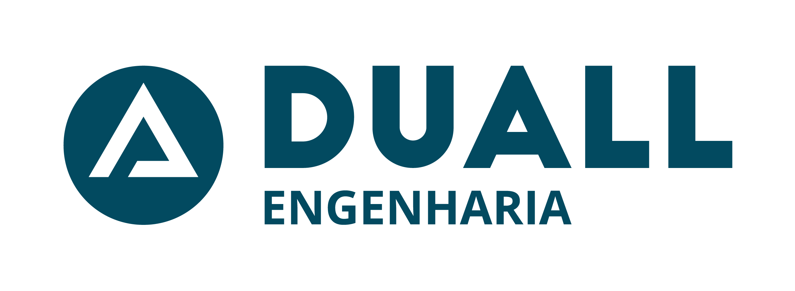

<div align="center">



# Site institucional da Duall Engenharia

**Know-how em projetos de instalações elétricas e hidráulicas**

React 19 · Vite 6 · Tailwind CSS 4 · Three.js · Pré-renderização estática (SSG) otimizada para busca e IA (GEO)

</div>

---

## Sobre

Site institucional da [Duall Engenharia](https://duallengenharia.com.br), escritório de projetos de instalações elétricas, hidráulicas, infraestrutura para sistemas, BIM, Duall Dynamic e Consultoria ATP.

O site é construído para ser **lido por buscadores e sistemas de IA** (GEO): cada rota é pré-renderizada em HTML estático, com metadados, dados estruturados (JSON-LD), sitemap, `robots.txt` e `llms.txt`. O JavaScript apenas "hidrata" a página depois.

### Destaques

- **Hero com cena 3D** (o "bairro Duall") em Three.js, carregada depois do texto para não prejudicar o LCP, com fallback estático e suporte a `prefers-reduced-motion`
- **Navegador IFC 3D** interativo na página de Modelagem BIM
- **39 páginas de projeto** geradas a partir do portfólio, com filtros por tipo e cliente
- **Acessibilidade**: painel de contraste e tamanho de fonte, link "ir para o conteúdo", navegação por teclado
- **Animações de rolagem em CSS puro** (scroll-driven animations), sem custo de JavaScript

## Mapa do site

| Rota | Página |
| --- | --- |
| `/` | Home (hero, projetos, soluções, Duall Dynamic, clientes e números, conteúdo e FAQ, contato) |
| `/projetos` · `/projetos/[slug]` | Portfólio e página de cada empreendimento |
| `/solucoes` · `/solucoes/[slug]` | Hub e as 6 soluções: `eletrica`, `hidraulica`, `sistemas`, `bim`, `duall-dynamic`, `consultoria-atp` |
| `/a-duall` | Quem somos, unidades, clientes e depoimentos |
| Trabalhe conosco | Sem página própria: botões na navbar, no rodapé e na Home abrem direto o portal de talentos (`SITE.careersUrl`) |
| `/conteudo` · `/conteudo/artigos` · `/conteudo/artigos/[slug]` · `/conteudo/workshop-tecnico` | Artigos e Workshop Técnico |
| `/contato` | Formulário, WhatsApp e chatbot |
| `/politica-de-privacidade` | Política de privacidade |

## Como rodar

**Pré-requisito:** Node.js 20 ou superior.

```bash
# 1. Instalar dependências
npm install

# 2. Rodar em desenvolvimento
npm run dev
# abre em http://localhost:3002
```

### Scripts

| Comando | O que faz |
| --- | --- |
| `npm run dev` | Servidor de desenvolvimento (porta 3002) |
| `npm run build` | Build completo: cliente, bundle SSR e pré-renderização de todas as rotas em `dist/` |
| `npm run preview` | Servidor de preview do `dist/` (ver observação abaixo) |
| `npm run lint` | Checagem de tipos (`tsc --noEmit`) |
| `npm run clean` | Remove `dist/` e `dist-ssr/` |

> **Preview:** o `vite preview` usa fallback SPA e serve sempre a Home. Para testar o HTML pré-renderizado de cada rota, sirva a pasta `dist/` com um servidor estático que entregue `rota/index.html`.

### Variáveis de ambiente

| Variável | Uso |
| --- | --- |
| `VITE_SITE_URL` | URL pública do site (canonical, sitemap, JSON-LD, Open Graph). Padrão: `https://duallengenharia.com.br` |

Exemplo: `VITE_SITE_URL=https://www.exemplo.com.br npm run build`

## Como funciona o build (SSG)

```text
npm run build
 ├─ vite build                              → dist/ (bundle do navegador)
 ├─ vite build --ssr src/entry-server.tsx   → dist-ssr/ (bundle de servidor)
 └─ node scripts/prerender.mjs              → HTML por rota + arquivos de SEO
```

O script de pré-render ([scripts/prerender.mjs](scripts/prerender.mjs)) renderiza cada rota listada em `getRoutes()` ([src/entry-server.tsx](src/entry-server.tsx)) e gera:

- `dist/<rota>/index.html` para cada página, e `dist/404.html`
- `sitemap.xml`
- `robots.txt` liberando rastreadores de busca e de IA (GPTBot, ClaudeBot, PerplexityBot, Google-Extended etc.)
- `llms.txt` (índice para LLMs) e `llms-full.txt` (texto das páginas principais)

**Hospedagem:** qualquer host estático, desde que sirva `rota/index.html` e o `404.html`. Não use fallback SPA para `index.html`, pois isso quebra o SEO.

## Estrutura do projeto

```text
src/
├─ content/        Conteúdo do site (editar aqui)
│  ├─ site.ts        dados institucionais, unidades, navegação
│  ├─ solutions.ts   soluções e textos do Duall Dynamic
│  ├─ projects.ts    portfólio (gera /projetos/[slug])
│  ├─ articles.ts    artigos (gera /conteudo/artigos/[slug])
│  ├─ faq.ts         perguntas frequentes (HTML + JSON-LD)
│  └─ clients.ts     logos de clientes e números institucionais
├─ seo/            <Seo> (head por página) e construtores de JSON-LD
├─ pages/          uma página por rota
├─ sections/       blocos da Home, cabeçalho e rodapé
├─ components/     layout, hero 3D, simulador IFC, formulário, UI comum
├─ entry-server.tsx  render de servidor e lista de rotas
└─ main.tsx          entrada do navegador (hidratação)
scripts/prerender.mjs   pré-renderização e arquivos de SEO
public/                 logo, imagem Open Graph e web-ifc.wasm
```

## Como editar o conteúdo

- **Novo projeto no portfólio:** adicione a imagem em `src/assets/images/projetos/` e uma entrada em [src/content/projects.ts](src/content/projects.ts). A página, o sitemap e o JSON-LD são gerados no build.
- **Novo artigo:** adicione um item em [src/content/articles.ts](src/content/articles.ts) (slug, título, data ISO, resumo e parágrafos).
- **Novo cliente:** coloque o logo em `src/assets/images/clients/` (o nome do arquivo vira o nome exibido; ajustes em `NAME_OVERRIDES` de [clients.ts](src/content/clients.ts)).
- **Textos das soluções e FAQ:** [solutions.ts](src/content/solutions.ts) e [faq.ts](src/content/faq.ts). O texto da FAQ é o mesmo do HTML e do JSON-LD.
- **Dados da empresa** (unidades, WhatsApp, redes): [site.ts](src/content/site.ts). Valores `null` não são exibidos nem entram no schema.
- **Chatbot:** quando o script do fornecedor estiver na página, ele deve expor `window.DuallChatbot.open()` (veja [src/utils/chatbot.ts](src/utils/chatbot.ts)).

Dados ainda a confirmar com a Duall estão listados em [PENDENCIAS.txt](PENDENCIAS.txt).

## Boas práticas adotadas (GEO)

- Um único `<h1>` por página, hierarquia de títulos e HTML semântico
- Título, descrição, canonical e Open Graph por rota
- JSON-LD: Organization, WebSite, FAQPage, Service, ItemList, BreadcrumbList, CreativeWork, Article e Event
- Mesma definição repetida de forma idêntica onde importa (ex.: Duall Dynamic na Home e na página própria)
- Nenhum número ou dado entra sem origem confirmada pela Duall
- Texto sempre em HTML real, nunca dentro de imagem ou canvas
